# Rockport Native · Need for Speed: Most Wanted (2005)

[Español](README.md) · **English**

<a href="https://rockport-native.vercel.app">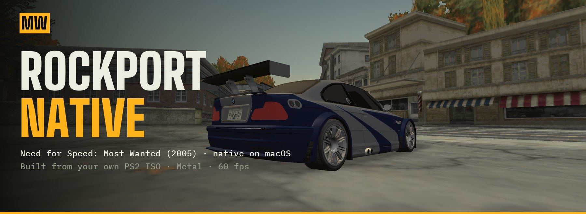</a>

<p align="center"><b><a href="https://github.com/pablonolascoo/nfs-mw-2005-ps2-port/releases/latest">⬇️ Download for Mac (v0.7.1)</a></b> · <a href="https://rockport-native.vercel.app">🌐 Project page</a> · <a href="#user-guide">User guide</a> · <a href="#the-rust-belt-expansion">The expansion</a> · <a href="ROADMAP.en.md">Roadmap</a> · <a href="CONTRIBUTING.md">Contribute</a> · <a href="CONTEXT.md">Context</a></p>

**An open decompilation and reverse-engineering project** for the **PlayStation 2** *Need for Speed: Most Wanted* (2005). We read your own ISO, understand every format and game system (helped by the [dbalatoni13/nfsmw](https://github.com/dbalatoni13/nfsmw) decomp) and rebuild it as a **native game**, faithful to the original: same city, same cars, same interface, same warm PS2 tone.

Then **we expand it**: an expansion that continues the story as if the same studio had made it in 2006.

> **No game data is included.** You need your own disc (PAL SLES-53559 or NTSC-U SLUS-21351). Everything is generated on your machine from your ISO. Non-profit fan project, not affiliated with Electronic Arts.

## Three parts, one goal

| | What | Status |
|---|---|---|
| 🔬 **Decompilation** | Disc formats, database, physics, AI, interface, audio, movies, music, scenes… all documented in [`docs/`](docs/en), every fact tagged ([V] verified, [D] decomp, [I] inferred, [H] hypothesis) | ✅ **99.94 % of the disc understood** ([doc 21](docs/en/21-coverage.md)) |
| 🖥️ **Native port** | Own engine that plays Rockport from your ISO, no emulator | ✅ playable on Mac (v0.7) |
| 🗺️ **"Rust Belt" expansion** | 4 new districts, Blacklist 2, classic cars, the story continues | 🧭 designed, [see below](#the-rust-belt-expansion) |

### Platforms
| Platform | Status | How |
|---|---|---|
| **macOS** (Apple Silicon) | ✅ **playable** · `.dmg` in [Releases](https://github.com/pablonolascoo/nfs-mw-2005-ps2-port/releases/latest) | Swift + Metal, full screen at your screen's resolution |
| **Windows** | 🔜 possible | The converter (`tools/`, TypeScript + Bun) already runs on Windows. It needs a DirectX 12 or Vulkan engine reading the same data |
| **iPhone / iPad** | 🔜 possible | Same Metal and controllers as on Mac; touch controls and memory need adapting |
| **Android / Linux** | 💡 idea | Vulkan + the same converted data |

The converted data (glTF, PNG, JSON) is open and platform-independent: anyone can write an engine on top. Fancy Windows or mobile? See [CONTRIBUTING.md](CONTRIBUTING.md).

### The expansion, in one picture

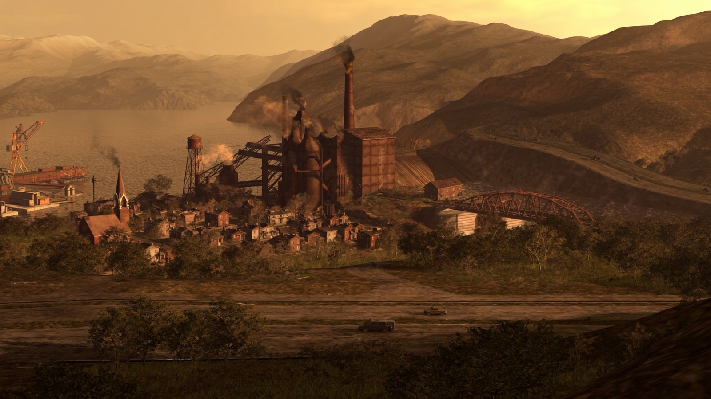

Beating Razor opens an industrial Rust Belt county around Rockport: **Millbrook**, **River Steelworks**, **Freight Harbor** and **High Ridge**. A new Blacklist of 15, classic cars (Countach, Testarossa, 959…), new pursuits and the story goes on. [Map, sketches and story →](#the-rust-belt-expansion)

## In pictures

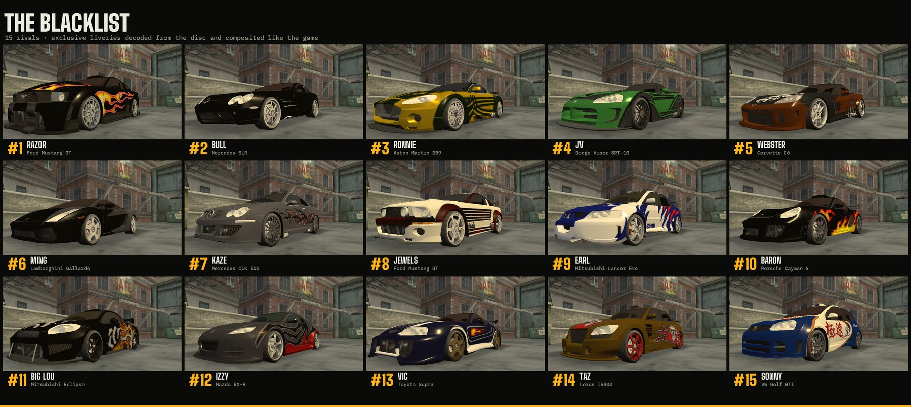

| Race with the original HUD | Police pursuit |
|---|---|
| 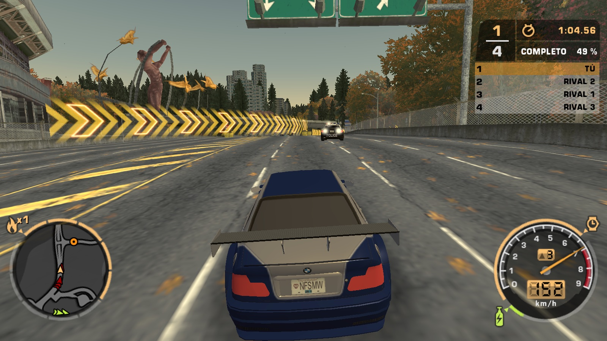 | 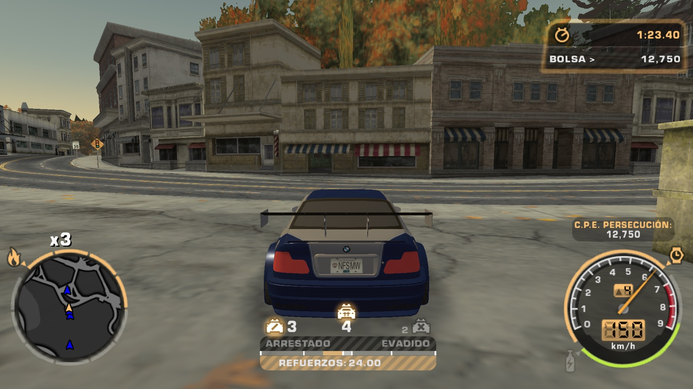 |
| **Main menu: the water-tower yard** | **Your safehouse, with the Blacklist chalkboard** |
| 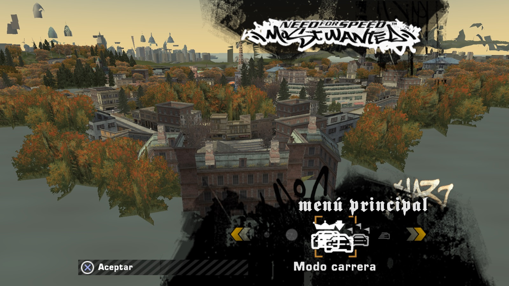 | 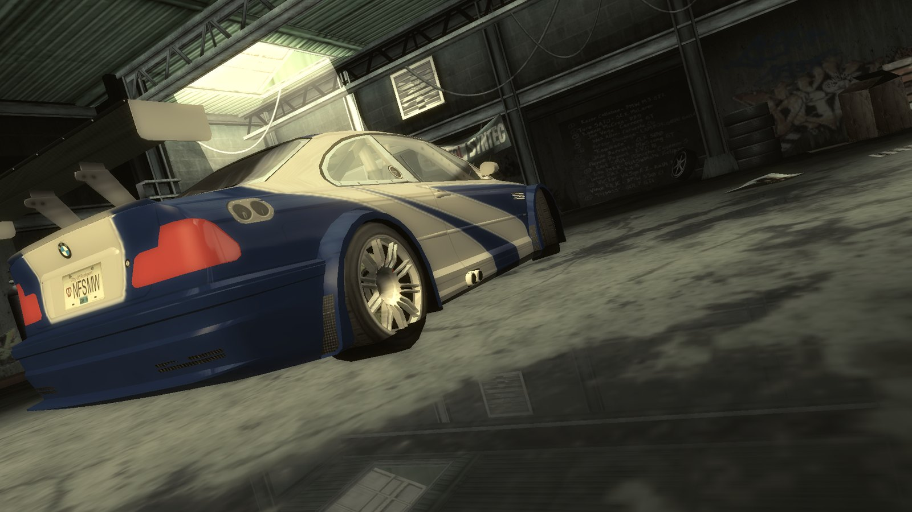 |
| **Customization shop, no loading screens** | **Blacklist screen** |
| 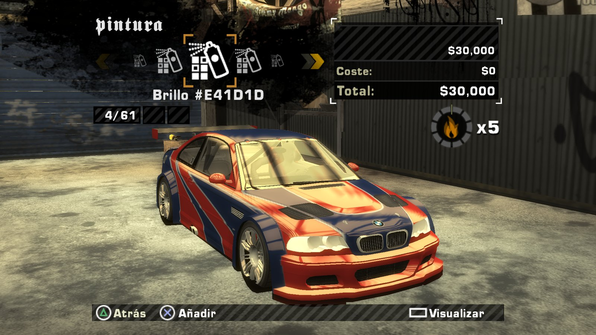 | 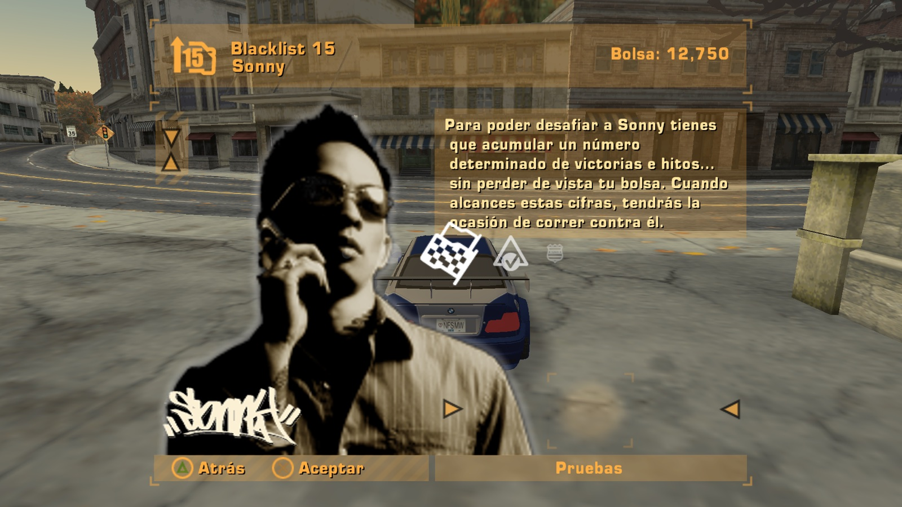 |

## What works today

### The game (native macOS engine, v0.7)
| | Status |
|---|---|
| All of Rockport full screen at your screen's resolution and 60 fps, with the warm PS2 tone always on | ✅ |
| **Original interface**: "Press START", menus, pause and a 100 % original HUD, with text from your disc — [doc 17](docs/en/17-interface.md) | ✅ |
| **The game's own driving physics** (decompiled), 4 cameras — [doc 13](docs/en/13-driving-physics.md) | ✅ |
| **Story cars with their exact liveries**: silver/blue BMW M3 GTR, Razor's Mustang, all 15 Blacklist cars — [doc 10](docs/en/10-cars.md) | ✅ |
| **Races and Blacklist**: sprint, circuit, knockout, drag, speedtrap, tollbooth and challenges; 15 → 1 progression, pink slips and save game — [doc 18](docs/en/18-races-and-blacklist.md) | ✅ |
| **Traffic, police and pursuits** with the game's tables, police radio from your disc — [doc 14](docs/en/14-traffic-and-police.md) | ✅ |
| **Garages without loading screens**: safehouse, car lot and customization shop — [doc 07](docs/en/07-driving-and-garages.md) | ✅ |
| **Original sound**: each car's engine, turbo, shifts, nitrous, skids, impacts, sirens — [doc 16](docs/en/16-audio-and-voices.md) | ✅ |
| **Quick Race and split screen** (2 players as the original; 3–4 and multi-display as extensions) — [doc 19](docs/en/19-quick-race-and-multiplayer.md) | ✅ |
| **Controllers**: Xbox, PS3/PS4/PS5 and PS2 via USB, with light bar, touchpad and DualSense triggers — [doc 15](docs/en/15-controllers.md) | ✅ (untested on real hardware) |
| **The game's lighting**: car reflections from the disc's environment maps, shadow, sky, sun and glow; garages faithful to the original — [doc 20](docs/en/20-lighting-and-effects.md) | ✅ |
| **Movies** from your ISO, with the disc's Spanish dub on PAL: logos, intro, Blacklist presentations and story — [doc 22](docs/en/22-movies-subtitles-and-collision.md) | ✅ |
| **EA Trax music** and pursuit music with the game's logic — [doc 25](docs/en/25-music-and-mixing.md) | ✅ |
| **Particles, flares and per-zone fog**: tyre smoke, nitrous, sparks, traffic lights, headlights, police lights — [doc 24](docs/en/24-effects-lights-and-world.md) | ✅ |
| **Crashes and damage**: cars collide with the game's collision, destroyed cops, 5,952 breakables, pursuit breakers and the **helicopter** — [doc 14](docs/en/14-traffic-and-police.md) | ✅ |
| Career map, spike strips blowing tyres, full options menu | 🔜 |

### The reverse engineering
| | Status |
|---|---|
| Disc container, file names (95 %), HUFF/JDLZ/RAWW compression byte-exact | ✅ |
| PS2 geometry and textures (VIF, GS swizzle), 181,535 strips with zero errors | ✅ |
| Rockport: 718 sections, 106,714 objects, 5.8 M triangles | ✅ |
| Game database (VLT): 6,287 collections, 255 events | ✅ |
| Road network (4385 nodes, Bézier, lanes) and collision (243k triangles) | ✅ |
| Interface (FEng), sound (ABK, GIN, MicroTalk), preset cars and vinyls, race routes | ✅ |
| The [dbalatoni13/nfsmw](https://github.com/dbalatoni13/nfsmw) decomp building on Apple Silicon | ✅ |
| Research web viewer (Three.js) and data mods (`mods/`) | ✅ |

## Quick Race and split screen

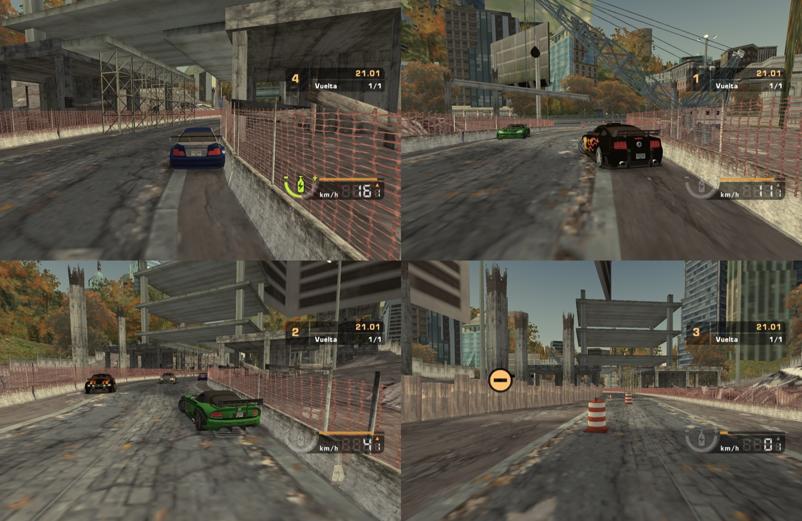

Quick Race uses the game's own screens: race type, track select with each event's map, options and car select. **Two-player split screen as in the original** (horizontal, with the disc's split-screen HUD) and, as a port extension, **3 and 4 players** and **several displays at once** (e.g. 2 players per monitor).

Each player uses their own controller (Xbox, DualSense, DualShock 4, DualShock 3, PS2 adapter or the keyboard) **with no input mixing**: "Press START" to join, the first one is player 1 and drives the menus, each pad only moves its own car, light bar and LED take your player's colour, and the race pauses if a controller is unplugged until it's back. `--race 15.1.1 --players 2` starts directly; `--displays all` uses every display. Details: [doc 19](docs/en/19-quick-race-and-multiplayer.md).

## Play on your Mac
1. Download `Rockport-<version>.dmg` from [Releases](https://github.com/pablonolascoo/nfs-mw-2005-ps2-port/releases) and drag **Rockport** to Applications.
2. Open it (first time: right-click → Open, it is not notarised yet).
3. Choose your PS2 ISO. It detects **PAL SLES-53559** or **NTSC-U SLUS-21351** and converts the game in about 1 minute.
4. The game starts full screen at your screen's resolution. Converted data stays in `~/Library/Application Support/Rockport/`.

Build the `.dmg` yourself: `native-engine/scripts/make-dmg.sh` (needs Xcode tools and Bun). Details: [native-engine/README.en.md](native-engine/README.en.md).

## The "Rust Belt" expansion

A fan-made expansion **as if it were 2006**. It unlocks after beating the original Blacklist and continues the story with a **Blacklist 2** of 15 rivals with unique cars. Same look: Rust Belt, autumn and the warm PS2 tone.


| Map: real Rockport + 4 new districts | Districts |
|---|---|
| 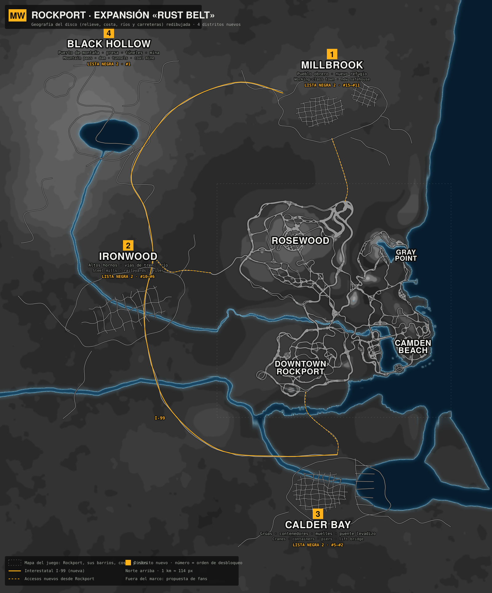 | **1 · Millbrook**: working-class town, new safehouse (Blacklist 2 #15–#11)<br>**2 · River Steelworks**: blast furnaces and rail yards (#10–#6)<br>**3 · Freight Harbor**: cranes and containers (#5–#2)<br>**4 · High Ridge**: mountain pass and dam (#1)<br><br>Linked by the **I-99** interstate. Classic cars such as the Countach, Testarossa or 959. |

| River Steelworks | Freight Harbor | High Ridge | Bridge and I-99 |
|---|---|---|---|
|  |  |  | 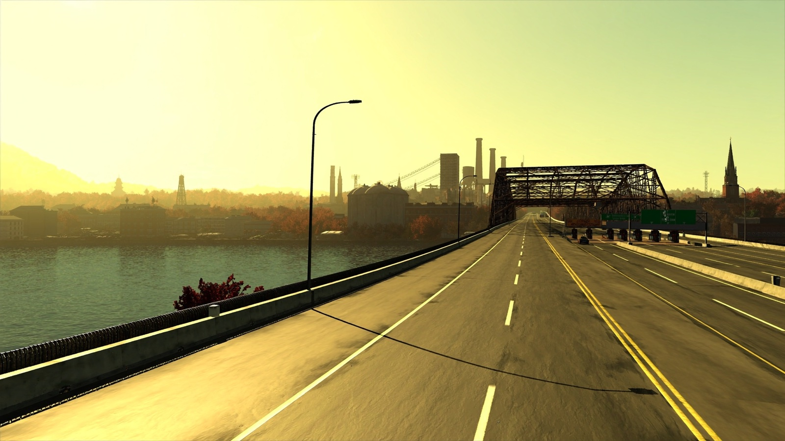 |

Full design, story and modelling rules: [docs/en/12-rust-belt-expansion.md](docs/en/12-rust-belt-expansion.md). AI mood sketches (not game assets).

## User guide

### First launch
1. Open **Rockport** from Applications. First time: right-click → **Open** (the app is not signed by Apple yet).
2. Click **CHOOSE MY PS2 ISO** and pick your copy. It detects PAL **SLES-53559** or NTSC-U **SLUS-21351** on its own.
3. Wait for the bar (about 1 minute).
4. "Press START" → **Career** → **Start new** (or **Continue** if you have a save). There is also **Quick Race** to play alone or split screen.

### Controls

| Action | Xbox | PlayStation | Keyboard |
|---|---|---|---|
| Throttle (analog) | RT | R2 | W / ↑ |
| Brake and reverse (analog) | LT | L2 | S / ↓ |
| Steer | left stick | left stick | A D / ← → |
| Handbrake | A or RB | ✕ or R1 | Space |
| Nitrous | B | ○ | N or Shift |
| Look back (hold) | LB or L3 | L1 or L3 | X |
| Change camera (4 game views) | Y · d-pad → / ← | △ · d-pad → / ← | V |
| Reset the car onto the road | X or View | □ or Share / Create | R |
| Shift up / down | d-pad ↑ / ↓ | d-pad ↑ / ↓ | E / Q |
| Pause (resume, restart, quit to menu) | Menu | Options / Start | Esc |
| Free camera / photo mode | — | — | C |
| Release mouse | — | — | Tab |

- Gears are automatic, as in the game. Use the d-pad to shift by hand whenever you want.
- The right stick can also throttle (↑) and brake (↓).
- The warm, yellowish PS2 tone is **always** on: it is part of the game.

### PS4 (DualShock 4) and PS5 (DualSense) extras

| Extra | What it does |
|---|---|
| Light bar | Takes your car's colour. During a pursuit it flashes red and blue |
| Swipe → / ← on the touchpad | Next / previous camera |
| Press the touchpad (hold) | Look back while held |
| Short tap on the touchpad | 1-second glance back |
| Two fingers on the touchpad | Photo mode (free camera) and back to the car |
| Adaptive triggers (PS5 only) | L2 resists when braking and buzzes when the wheels lock. R2 is almost free, shakes at the rev limiter and goes loose with nitrous |
| Rumble | Follows tyre grip, the rev limiter, nitrous and hits |

### Pursuits
- **Top left**: heat level (HEAT, 1 to 5) and number of cops.
- **Bottom**: the **EVADE ← → BUSTED** bar.
  - Going slowly with a cop on you fills it towards **BUSTED**: you get arrested.
  - Once they lose sight of you, **COOLDOWN** starts. Stay hidden until **EVADED** appears.
- **To escape**: break line of sight (corners, tunnels, alleys) and use the game's hiding spots (under bridges, car parks). Cops can't see you there.
- **From heat 2** there are roadblocks, some with spike strips. Find the gap or take another street.
- **Cops chase you if** you speed past them, hit traffic or ram a patrol car.

### Supported controllers
- **No install needed**, wired or Bluetooth: Xbox One and Series, PS4, PS5, Switch Pro and MFi pads.
- **Wired only**: PS3 (DualShock 3) and PS2 pads through a USB adapter.
- **Xbox 360**: macOS needs the free [360Controller](https://github.com/360Controller/360Controller) driver. The game tells you if it is missing.
- Plug and unplug at any time. Full details: [docs/en/15-controllers.md](docs/en/15-controllers.md).

### Troubleshooting
| Problem | Fix |
|---|---|
| "Cannot be opened because the developer cannot be verified" | Right-click the app → **Open** → **Open** |
| A PS3, PS2 or generic pad does nothing | System Settings › Privacy & Security › **Input Monitoring** → enable Rockport |
| I want to convert my ISO again | Delete `~/Library/Application Support/Rockport/<ID>/` and open the app |
| I updated the app | If the data is from an older version, it is reconverted automatically from the same ISO |
| Uninstall | Delete **Rockport** from Applications and the `~/Library/Application Support/Rockport/` folder |

## Quick start (research tools)
**One PAL ISO (SLES-53559) is enough for the whole project** (SLUS-21351 also works).
```bash
# requirements: Bun and your own ISO
cd tools && bun install
bun run build-all /path/to/your.iso        # everything in ~6 min → map-data/<disc>/
cd ../viewer && bun install && bunx vite    # http://localhost:5181 → «Cargar ciudad completa» → «Conducir»
```
Step by step:
```bash
cd tools && bun install
bun src/cli/inventory.ts ../original/SLES-53559.iso SLES-53559
bun src/cli/convert.ts   ../original/SLES-53559.iso SLES-53559 tiles 400 3   # all of Rockport as 60-fps tiles (~1 min)
bun src/cli/convert.ts   ../original/SLES-53559.iso SLES-53559 interior CAREER_SAFEHOUSE CAR_LOT CUSTOMIZATION_SHOP
bun src/cli/vlt-dump.ts  ../original/SLES-53559.iso SLES-53559                # gameplay.json + zones.json
bun src/cli/convert.ts   ../original/SLES-53559.iso SLES-53559 car BMWM3GTRE46
bun src/cli/topdown.ts   ../original/SLES-53559.iso SLES-53559 4096          # top-down PNG map
cd ../viewer && bun install && bunx vite                                    # http://localhost:5181
```

## Documentation
Every document exists in English (`docs/en/`) and Spanish (`docs/es/`). To resume the project: **[CONTEXT.md](CONTEXT.md)**.

| # | Topic | English | Español |
|---|---|---|---|
| 00 | Disc identification | [en](docs/en/00-disc-identification.md) | [es](docs/es/00-identificacion-disco.md) |
| 01 | Decomp compatibility | [en](docs/en/01-sles53559-compatibility.md) | [es](docs/es/01-compatibilidad-sles53559.md) |
| 02 | PS2 formats | [en](docs/en/02-ps2-formats.md) | [es](docs/es/02-formatos-ps2.md) |
| 03 | The Rockport world | [en](docs/en/03-rockport-world-ps2.md) | [es](docs/es/03-mundo-rockport-ps2.md) |
| 04 | Port architecture | [en](docs/en/04-port-architecture.md) | [es](docs/es/04-arquitectura-port.md) |
| 05 | Game database (VLT) | [en](docs/en/05-vlt-attributes.md) | [es](docs/es/05-vlt-atributos.md) |
| 06 | Performance | [en](docs/en/06-performance.md) | [es](docs/es/06-rendimiento.md) |
| 07 | Driving and garages | [en](docs/en/07-driving-and-garages.md) | [es](docs/es/07-conduccion-y-garajes.md) |
| 08 | Mods | [en](docs/en/08-mods.md) | [es](docs/es/08-mods.md) |
| 09 | Road network and collision | [en](docs/en/09-road-network.md) | [es](docs/es/09-red-de-carreteras.md) |
| 10 | Cars, paints and vinyls | [en](docs/en/10-cars.md) | [es](docs/es/10-coches.md) |
| 11 | Generated data catalog | [en](docs/en/11-data-catalog.md) | [es](docs/es/11-catalogo-de-datos.md) |
| 12 | "Rust Belt" expansion | [en](docs/en/12-rust-belt-expansion.md) | [es](docs/es/12-expansion-rust-belt.md) |
| 13 | Driving physics | [en](docs/en/13-driving-physics.md) | [es](docs/es/13-fisica-conduccion.md) |
| 14 | Traffic, police and pursuits | [en](docs/en/14-traffic-and-police.md) | [es](docs/es/14-trafico-y-policia.md) |
| 15 | Controllers | [en](docs/en/15-controllers.md) | [es](docs/es/15-mandos.md) |
| 16 | Audio and voices | [en](docs/en/16-audio-and-voices.md) | [es](docs/es/16-audio-y-voces.md) |
| 17 | Original interface | [en](docs/en/17-interface.md) | [es](docs/es/17-interfaz.md) |
| 18 | Races and Blacklist | [en](docs/en/18-races-and-blacklist.md) | [es](docs/es/18-carreras-y-lista-negra.md) |
| 19 | Quick Race and multiplayer | [en](docs/en/19-quick-race-and-multiplayer.md) | [es](docs/es/19-carrera-rapida-y-multijugador.md) |
| 20 | Lighting and effects | [en](docs/en/20-lighting-and-effects.md) | [es](docs/es/20-iluminacion-y-efectos.md) |
| 21 | Disc coverage (what is decoded) | [en](docs/en/21-coverage.md) | [es](docs/es/21-cobertura.md) |
| 22 | Movies, subtitles and collision | [en](docs/en/22-movies-subtitles-and-collision.md) | [es](docs/es/22-peliculas-subtitulos-y-colision.md) |
| 23 | In-engine scenes (NIS) | [en](docs/en/23-nis-scenes.md) | [es](docs/es/23-escenas-nis.md) |
| 24 | Particles, flares and world data | [en](docs/en/24-effects-lights-and-world.md) | [es](docs/es/24-efectos-luces-y-mundo.md) |
| 25 | Music and mixing | [en](docs/en/25-music-and-mixing.md) | [es](docs/es/25-musica-y-mezcla.md) |

Every claim is tagged **[V]** verified on real data, **[D]** from the decomp's debug types, **[I]** inferred, or **[H]** hypothesis.

## Layout
`tools/` format readers and converters (TypeScript/Bun, platform-independent) · `viewer/` Three.js viewer · `docs/` research · `inventory/` per-disc inventories (hashes and sizes only).

## Credits
- [dbalatoni13/nfsmw](https://github.com/dbalatoni13/nfsmw) (CC0): PS2 debug types, chunk IDs, LZ/HUFF source.
- [TsyVM/MWEncyclopedia](https://github.com/TsyVM/MWEncyclopedia): PC format reference.
- GS memory tables follow the public GS documentation (same as PCSX2).

## License
MIT (code and docs). See [LICENSE](LICENSE).
