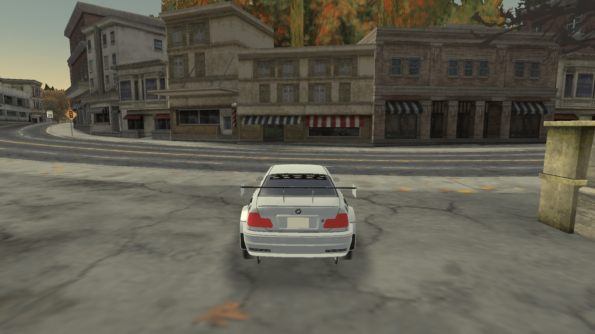
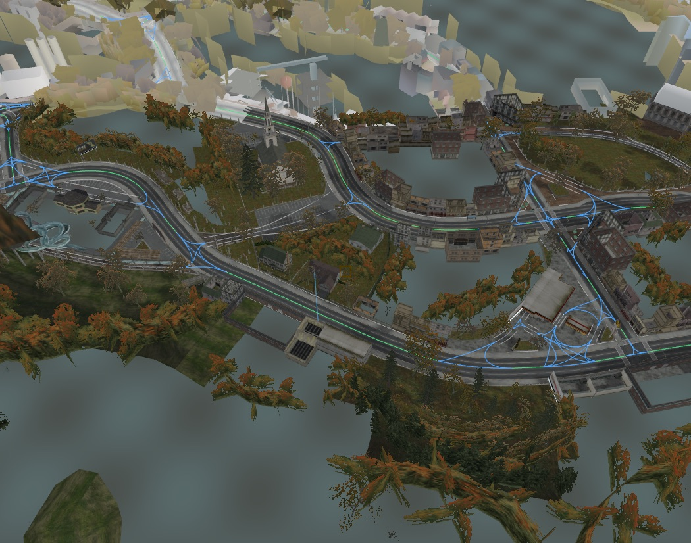
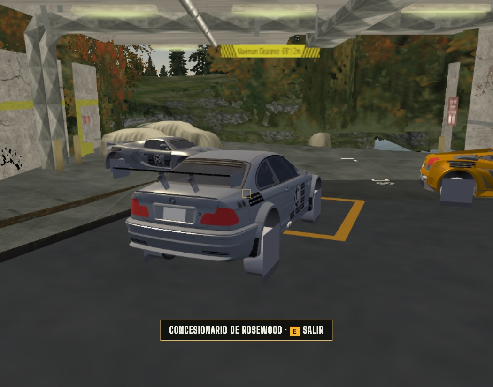

# NFS Most Wanted (2005) · PS2 → nativo

Español · [English](README.md)

<a href="https://rockport-native.vercel.app"></a>

**🌐 Página del proyecto: [rockport-native.vercel.app](https://rockport-native.vercel.app)** · [Hoja de ruta y expansión](ROADMAP.md) · [Colaborar](CONTRIBUTING.md) · [Contexto del proyecto](CONTEXT.md)

| Red de carreteras sobre la ciudad | Garaje sin pantallas de carga |
|---|---|
|  |  |

Investigación y herramientas abiertas para convertir tu propia copia de **PlayStation 2** de *Need for Speed: Most Wanted* (2005) en formatos abiertos (glTF/PNG/JSON). Es la base para **ports nativos a cualquier plataforma**, empezando por macOS.

> **No incluye datos del juego.** Necesitas tu propio disco. Todo lee tu ISO y escribe los derivados en tu equipo. Proyecto sin relación con Electronic Arts.

## Qué funciona hoy
| Área | Estado |
|---|---|
| Contenedor del disco (ZDIR/ZZDATA) y nombres | ✅ 95 % de archivos con nombre |
| Compresión HUFF / JDLZ / RAWW | ✅ exacta byte a byte |
| Geometría PS2 (paquetes VIF, cortes de tira) | ✅ 181.535 tiras, 0 errores |
| Texturas PS2 PSMT8 / PSMT4 (swizzle del GS) | ✅ |
| Rockport entero: 718 secciones, 106.714 objetos, 5,8 M triángulos | ✅ exportado a glTF |
| Coches con texturas, pintura, cristales, pilotos y 4 ruedas (TireOffsets) | ✅ |
| **Motor nativo de macOS (Swift + Metal)**: pantalla completa, resolución de la pantalla, 60 fps, tono PS2, coche conducible — [native-engine/](native-engine/README.md) | ✅ primera versión |
| Visor web de investigación (Three.js) | ✅ |
| Descompilación (dbalatoni13/nfsmw) en Apple Silicon | ✅ con Rosetta 2 |
| Base de datos del juego (VLT): 6.287 colecciones, 255 eventos, Blacklist, 15 zonas de garaje/tienda | ✅ |
| Interiores del menú (garajes, concesionario, taller) | ✅ exportados |
| Ciudad entera a 60 fps (casillas HLOD, arrays de texturas, workers, resolución dinámica) | ✅ |
| Coche conducible sobre la ciudad real (prototipo arcade, 60 fps) | ✅ |
| Garajes sin pantallas de carga: se abre la puerta real, interior ya cargado, aparcas, vista de exposición, sales conduciendo | ✅ |
| Mods: datos propios sobre tu ISO (`mods/`), ejemplo «Garajes únicos» | ✅ |
| Red de carreteras (4385 nodos, 6538 tramos Bézier, carriles) y colisión (243 mil triángulos) | ✅ decodificada y validada |
| Física del juego, carreras jugables, audio | 🔜 |

## Inicio rápido
**Con una sola ISO PAL (SLES-53559) basta para todo el proyecto** (también vale SLUS-21351).
```bash
# requisitos: Bun y tu propia ISO
cd tools && bun install
bun run build-all /ruta/a/tu.iso          # todo en ~6 min → map-data/<disco>/
cd ../viewer && bun install && bunx vite   # http://localhost:5181 → «Cargar ciudad completa» → «Conducir»
```
Paso a paso:
```bash
cd tools && bun install
bun src/cli/inventory.ts ../original/SLES-53559.iso SLES-53559
bun src/cli/convert.ts   ../original/SLES-53559.iso SLES-53559 tiles 400 3   # Rockport entero en casillas a 60 fps (~1 min)
bun src/cli/convert.ts   ../original/SLES-53559.iso SLES-53559 interior CAREER_SAFEHOUSE CAR_LOT CUSTOMIZATION_SHOP
bun src/cli/vlt-dump.ts  ../original/SLES-53559.iso SLES-53559                # gameplay.json + zones.json
bun src/cli/convert.ts   ../original/SLES-53559.iso SLES-53559 car BMWM3GTRE46
bun src/cli/topdown.ts   ../original/SLES-53559.iso SLES-53559 4096          # plano cenital PNG
cd ../viewer && bun install && bunx vite                                    # http://localhost:5181
```

## Documentación
Ver la tabla del [README en inglés](README.md#documentation): cada documento existe en `docs/es/` y `docs/en/`.

Para retomar el proyecto en cualquier momento: **[CONTEXT.md](CONTEXT.md)** (estado, rutas, comandos, pendientes) y el índice [docs/es/README.md](docs/es/README.md).
Nuevos: [09 Red de carreteras](docs/es/09-red-de-carreteras.md) · [10 Coches](docs/es/10-coches.md) · [11 Catálogo de datos](docs/es/11-catalogo-de-datos.md).
Cada afirmación lleva **[V]** verificado, **[D]** tipos de depuración de la decomp, **[I]** inferido o **[H]** hipótesis.

## Licencia
MIT (código y documentación). Ver [LICENSE](LICENSE).
