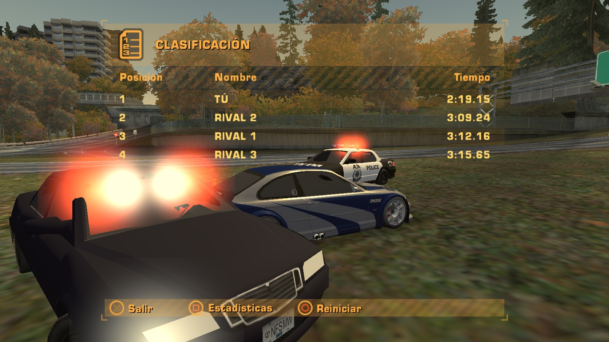

# Rockport Native · Need for Speed: Most Wanted (2005)

**Español** · [English](README.en.md)

<a href="https://rockport-native.vercel.app"></a>

<p align="center"><b><a href="https://github.com/pablonolascoo/nfs-mw-2005-ps2-port/releases/latest">⬇️ Descargar para Mac (v0.4)</a></b> · <a href="https://rockport-native.vercel.app">🌐 Página del proyecto</a> · <a href="#guía-de-uso">Guía de uso</a> · <a href="#la-ampliación-rust-belt">La expansión</a> · <a href="ROADMAP.md">Hoja de ruta</a> · <a href="CONTRIBUTING.md">Colaborar</a> · <a href="CONTEXT.md">Contexto</a></p>

**Proyecto abierto de decompilación e ingeniería inversa** del *Need for Speed: Most Wanted* (2005) de **PlayStation 2**. Leemos tu propia ISO, entendemos cada formato y cada sistema del juego (con ayuda de la decomp [dbalatoni13/nfsmw](https://github.com/dbalatoni13/nfsmw)) y lo volvemos a montar como **juego nativo**, fiel al original: misma ciudad, mismos coches, misma interfaz, mismo tono cálido de PS2.

Y después, **lo ampliamos**: una expansión que continúa la historia como si la hubiera hecho el mismo estudio en 2006.

> **No incluye datos del juego.** Necesitas tu propio disco (PAL SLES-53559 o NTSC-U SLUS-21351). Todo se genera en tu equipo a partir de tu ISO. Proyecto de fans sin ánimo de lucro, sin relación con Electronic Arts.

## Tres partes, un objetivo

| | Qué | Estado |
|---|---|---|
| 🔬 **Decompilación** | Formatos del disco, base de datos, física, IA, interfaz, audio… todo documentado en [`docs/`](docs/es) con cada dato etiquetado ([V] verificado, [D] decomp, [I] inferido, [H] hipótesis) | ✅ muy avanzada |
| 🖥️ **Port nativo** | Motor propio que juega Rockport desde tu ISO, sin emulador | ✅ jugable en Mac (v0.4) |
| 🗺️ **Expansión «Rust Belt»** | 4 distritos nuevos, Lista Negra 2, coches clásicos, la historia continúa | 🧭 diseñada, [ver abajo](#la-ampliación-rust-belt) |

### Plataformas
| Plataforma | Estado | Cómo |
|---|---|---|
| **macOS** (Apple Silicon) | ✅ **jugable** · `.dmg` en [Releases](https://github.com/pablonolascoo/nfs-mw-2005-ps2-port/releases/latest) | Swift + Metal, a pantalla completa y a la resolución de tu pantalla |
| **Windows** | 🔜 posible | El conversor (`tools/`, TypeScript + Bun) ya funciona en Windows. Falta un motor con DirectX 12 o Vulkan que lea los mismos datos |
| **iPhone / iPad** | 🔜 posible | Mismo Metal y mismos mandos que en Mac; habría que adaptar los controles táctiles y la memoria |
| **Android / Linux** | 💡 idea | Vulkan + los mismos datos convertidos |

Los datos convertidos (glTF, PNG, JSON) son abiertos y no dependen de la plataforma: cualquiera puede escribir su motor encima. ¿Te animas con Windows o con móvil? Mira [CONTRIBUTING.md](CONTRIBUTING.md).

### La expansión, en una imagen


Al vencer a Razor se abre un condado industrial del Rust Belt alrededor de Rockport: **Millbrook**, **Acerías del Río**, **Puerto de Mercancías** y **Sierra Alta**. Una nueva Lista Negra de 15, coches clásicos (Countach, Testarossa, 959…), persecuciones nuevas y la historia que sigue. [Plano, bocetos e historia →](#la-ampliación-rust-belt)

## En imágenes


| Carrera con el HUD original | Persecución con la policía |
|---|---|
|  |  |
| **Resultados de la carrera** | **Pantalla de la Lista Negra** |
|  |  |

## Qué funciona hoy
| Área | Estado |
|---|---|
| Contenedor del disco (ZDIR/ZZDATA) y nombres | ✅ 95 % de archivos con nombre |
| Compresión HUFF / JDLZ / RAWW | ✅ exacta byte a byte |
| Geometría PS2 (paquetes VIF, cortes de tira) | ✅ 181.535 tiras, 0 errores |
| Texturas PS2 PSMT8 / PSMT4 (swizzle del GS) | ✅ |
| Rockport entero: 718 secciones, 106.714 objetos, 5,8 M triángulos | ✅ exportado a glTF |
| Coches con texturas, pintura, cristales, pilotos y 4 ruedas (TireOffsets) | ✅ |
| **Motor nativo de macOS (Swift + Metal)**: pantalla completa, resolución de la pantalla, 60 fps, tono PS2, coche conducible — [native-engine/](native-engine/README.md) | ✅ primera versión |
| Visor web de investigación (Three.js) | ✅ |
| Descompilación (dbalatoni13/nfsmw) en Apple Silicon | ✅ con Rosetta 2 |
| Base de datos del juego (VLT): 6.287 colecciones, 255 eventos, Blacklist, 15 zonas de garaje/tienda | ✅ |
| Interiores del menú (garajes, concesionario, taller) | ✅ exportados |
| Ciudad entera a 60 fps (casillas HLOD, arrays de texturas, workers, resolución dinámica) | ✅ |
| Garajes sin pantallas de carga en el visor de investigación: se abre la puerta real, interior ya cargado, aparcas y sales conduciendo | ✅ |
| Mods: datos propios sobre tu ISO (`mods/`), ejemplo «Garajes únicos» | ✅ |
| Red de carreteras (4385 nodos, 6538 tramos Bézier, carriles) y colisión (243 mil triángulos) | ✅ decodificada y validada |
| **Física de conducción del juego original** (decomp), 4 cámaras, mandos (Xbox, PS3/PS4/PS5, PS2 por USB) con barra de luz y táctil — [doc 13](docs/es/13-fisica-conduccion.md), [doc 15](docs/es/15-mandos.md) | ✅ v0.2 |
| **Tráfico, policía y persecuciones** con las tablas del juego: notoriedad, refuerzos, formaciones, controles — [doc 14](docs/es/14-trafico-y-policia.md) | ✅ v0.2 |
| **Interfaz original del juego** a resolución nativa: «Pulsa START», menú principal, carrera, pausa y HUD de MW, con los textos en castellano de tu disco — [doc 17](docs/es/17-interfaz.md) | ✅ v0.3 |
| **Coches de la historia con su pintura exacta**: BMW M3 GTR gris con franjas azules, Mustang de Razor y los 15 de la Lista Negra (82 coches preparados, vinilos montados como el juego) — [doc 10](docs/es/10-coches.md) | ✅ v0.3 |
| **Radio de la policía** de tu disco (decodificador MicroTalk propio), según lo que pasa, por el altavoz del mando PS4/PS5 o el Mac; barra de luz configurable — [doc 15](docs/es/15-mandos.md), [doc 16](docs/es/16-audio-y-voces.md) | ✅ v0.3 |
| Voces originales y audio de escenas extraídos de tu disco (uso local) — [doc 16](docs/es/16-audio-y-voces.md) | ✅ |
| **Carreras y Lista Negra jugables**: sprint, circuito, eliminación, drag, radar, peaje y desafíos; rivales con la IA del juego y sus coches; progresión 15 → 1, coches de rosa, candados de distrito y partida guardada — [doc 18](docs/es/18-carreras-y-lista-negra.md) | ✅ v0.4 |
| **HUD 100 % original** con radar del juego, pantallas de carrera, resultados, Lista Negra y final de persecución — [doc 17](docs/es/17-interfaz.md) | ✅ v0.4 |
| Garajes en el motor nativo, sonido de motor, películas, choques entre coches | 🔜 |

## Carrera rápida y pantalla partida


La carrera rápida va con las pantallas del juego: tipo de prueba, selección de pista con el mapa de cada prueba, opciones y selección de coche. **Pantalla partida para 2 jugadores como el original** (horizontal, con el HUD de pantalla partida del disco) y, como ampliación del port, **3 y 4 jugadores** y **varias pantallas a la vez** (por ejemplo, 2 jugadores en cada monitor).

Cada jugador usa su propio mando (Xbox, DualSense, DualShock 4, DualShock 3, adaptador de PS2 o el teclado) **sin mezclas**: «Pulsa START» para unirte, el primero es el jugador 1 y lleva los menús, cada mando mueve solo su coche, la barra de luz y el LED toman el color de tu jugador, y si se desenchufa un mando la partida se para hasta que vuelva. `--race 15.1.1 --players 2` empieza directamente; `--displays all` usa todas las pantallas. Detalle: [doc 19](docs/es/19-carrera-rapida-y-multijugador.md).

## Jugar en tu Mac
1. Descarga `Rockport-<versión>.dmg` de [Releases](https://github.com/pablonolascoo/nfs-mw-2005-ps2-port/releases) y arrastra **Rockport** a Aplicaciones.
2. Ábrelo (la primera vez: clic derecho → Abrir; aún no está notarizado).
3. Elige tu ISO de PS2. Detecta **PAL SLES-53559** o **NTSC-U SLUS-21351** y convierte el juego en alrededor de 1 minuto.
4. El juego arranca a pantalla completa y a la resolución de tu pantalla. Los datos convertidos quedan en `~/Library/Application Support/Rockport/`.

Montar el `.dmg` tú mismo: `native-engine/scripts/make-dmg.sh` (necesita las herramientas de Xcode y Bun). Detalle: [native-engine/README.md](native-engine/README.md).

## La ampliación «Rust Belt»

Una expansión hecha por fans **como si fuera de 2006**. Se desbloquea al vencer a la Lista Negra original y continúa la historia con una **Lista Negra 2** de 15 rivales con coches únicos. Misma estética: Rust Belt, otoño y el tono cálido de PS2.


| Plano: Rockport real + 4 distritos nuevos | Distritos |
|---|---|
|  | **1 · Millbrook**: pueblo obrero, nuevo refugio (Lista Negra 2 #15–#11)<br>**2 · Acerías del Río**: altos hornos y vías de tren (#10–#6)<br>**3 · Puerto de Mercancías**: grúas y contenedores (#5–#2)<br>**4 · Sierra Alta**: puerto de montaña y presa (#1)<br><br>Unidos por la interestatal **I-99**. Coches clásicos como el Countach, el Testarossa o el 959. |

| Acerías del Río | Puerto de Mercancías | Sierra Alta | Puente e I-99 |
|---|---|---|---|
|  |  |  |  |

Diseño completo, historia y reglas para modelar: [docs/es/12-expansion-rust-belt.md](docs/es/12-expansion-rust-belt.md). Bocetos de ambiente hechos con IA (no son recursos del juego).

## Guía de uso

### Primer arranque
1. Abre **Rockport** desde Aplicaciones. La primera vez: clic derecho → **Abrir** (la app aún no está firmada por Apple).
2. Pulsa **ELEGIR MI ISO DE PS2** y selecciona tu copia. Detecta sola PAL **SLES-53559** o NTSC-U **SLUS-21351**.
3. Espera a la barra (alrededor de 1 minuto). Al terminar, el juego arranca a pantalla completa y a la resolución de tu pantalla.
4. Pulsa **C** (o **Menú / Options** en el mando) para pasar de la cámara libre al coche.

### Controles

| Acción | Xbox | PlayStation | Teclado |
|---|---|---|---|
| Acelerar (analógico) | RT | R2 | W / ↑ |
| Frenar y marcha atrás (analógico) | LT | L2 | S / ↓ |
| Girar | stick izquierdo | stick izquierdo | A D / ← → |
| Freno de mano | A o RB | ✕ o R1 | Espacio |
| Nitro | B | ○ | N o Mayús |
| Mirar atrás (mantener) | LB o L3 | L1 o L3 | X |
| Cambiar de cámara (4 vistas del juego) | Y · cruceta → / ← | △ · cruceta → / ← | V |
| Recolocar el coche en la calle | X o Ver | □ o Share / Create | R |
| Subir / bajar marcha | cruceta ↑ / ↓ | cruceta ↑ / ↓ | E / Q |
| Cámara libre / modo foto | Menú | Options / Start | C |
| Soltar el ratón · Salir | — | — | Tab · Esc |

- El cambio es automático, como en el juego. La cruceta sirve para cambiar a mano cuando quieras.
- Con el stick derecho también puedes acelerar (↑) y frenar (↓).
- El tono cálido y amarillento de PS2 va **siempre** puesto: es parte del juego.

### Extras de PS4 (DualShock 4) y PS5 (DualSense)

| Extra | Qué hace |
|---|---|
| Barra de luz | Toma el color de tu coche. En una persecución parpadea en rojo y azul |
| Deslizar el dedo → / ← en el panel táctil | Cámara siguiente / anterior |
| Pulsar el panel táctil (mantener) | Mirar atrás mientras lo mantienes |
| Toque corto en el panel | Vistazo atrás de 1 segundo |
| Dos dedos en el panel | Cámara libre (modo foto) y vuelta al coche |
| Gatillos adaptativos (solo PS5) | L2 ofrece resistencia al frenar y vibra si las ruedas se bloquean. R2 casi libre, tiembla en el corte de inyección y se suelta con el nitro |
| Vibración | Según el agarre de las ruedas, el corte de inyección, el nitro y los golpes |

### Persecuciones
- **Arriba a la izquierda**: nivel de notoriedad (HEAT, de 1 a 5) y número de policías.
- **Abajo**: la barra **EVADE ← → BUSTED**.
  - Si vas lento con un policía encima, se llena hacia **BUSTED**: te arrestan.
  - Si les pierdes de vista, empieza el **COOLDOWN**. Aguanta sin que te vean y saldrá **EVADED**.
- **Para escapar**: corta la línea de visión (esquinas, túneles, callejones) y busca escondites del juego (bajo puentes, aparcamientos). Ahí la policía no te ve.
- **Desde la notoriedad 2** aparecen controles de carretera, algunos con pinchos. Busca el hueco o cambia de calle.
- **Te persiguen si** vas muy rápido delante de ellos, chocas con el tráfico o embistes a un coche patrulla.

### Mandos compatibles
- **Sin instalar nada**, por cable o Bluetooth: Xbox One y Series, PS4, PS5, Switch Pro y mandos MFi.
- **Solo por cable**: PS3 (DualShock 3) y mandos de PS2 con adaptador USB.
- **Xbox 360**: macOS necesita el driver gratuito [360Controller](https://github.com/360Controller/360Controller). El juego te avisa si falta.
- Se pueden conectar y desconectar en cualquier momento. Detalle completo: [docs/es/15-mandos.md](docs/es/15-mandos.md).

### Problemas frecuentes
| Problema | Solución |
|---|---|
| «No se puede abrir porque no se ha verificado el desarrollador» | Clic derecho en la app → **Abrir** → **Abrir** |
| Un mando PS3, PS2 o genérico no responde | Ajustes del Sistema › Privacidad y seguridad › **Monitorización de entrada** → activa Rockport |
| Quiero volver a convertir mi ISO | Borra `~/Library/Application Support/Rockport/<ID>/` y abre la app |
| Actualicé la app | Si los datos son de una versión anterior, se reconvierten solos con la misma ISO |
| Desinstalar | Borra **Rockport** de Aplicaciones y la carpeta `~/Library/Application Support/Rockport/` |

## Inicio rápido (herramientas de investigación)
**Con una sola ISO PAL (SLES-53559) basta para todo el proyecto** (también vale SLUS-21351).
```bash
# requisitos: Bun y tu propia ISO
cd tools && bun install
bun run build-all /ruta/a/tu.iso          # todo en ~6 min → map-data/<disco>/
cd ../viewer && bun install && bunx vite   # http://localhost:5181 → «Cargar ciudad completa» → «Conducir»
```
Paso a paso:
```bash
cd tools && bun install
bun src/cli/inventory.ts ../original/SLES-53559.iso SLES-53559
bun src/cli/convert.ts   ../original/SLES-53559.iso SLES-53559 tiles 400 3   # Rockport entero en casillas a 60 fps (~1 min)
bun src/cli/convert.ts   ../original/SLES-53559.iso SLES-53559 interior CAREER_SAFEHOUSE CAR_LOT CUSTOMIZATION_SHOP
bun src/cli/vlt-dump.ts  ../original/SLES-53559.iso SLES-53559                # gameplay.json + zones.json
bun src/cli/convert.ts   ../original/SLES-53559.iso SLES-53559 car BMWM3GTRE46
bun src/cli/topdown.ts   ../original/SLES-53559.iso SLES-53559 4096          # plano cenital PNG
cd ../viewer && bun install && bunx vite                                    # http://localhost:5181
```

## Documentación
Cada documento existe en español (`docs/es/`) y en inglés (`docs/en/`). Para retomar el proyecto: **[CONTEXT.md](CONTEXT.md)**.

| # | Tema | Español | English |
|---|---|---|---|
| 00 | Identificación del disco | [es](docs/es/00-identificacion-disco.md) | [en](docs/en/00-disc-identification.md) |
| 01 | Compatibilidad con la decomp | [es](docs/es/01-compatibilidad-sles53559.md) | [en](docs/en/01-sles53559-compatibility.md) |
| 02 | Formatos de PS2 | [es](docs/es/02-formatos-ps2.md) | [en](docs/en/02-ps2-formats.md) |
| 03 | El mundo de Rockport | [es](docs/es/03-mundo-rockport-ps2.md) | [en](docs/en/03-rockport-world-ps2.md) |
| 04 | Arquitectura del port | [es](docs/es/04-arquitectura-port.md) | [en](docs/en/04-port-architecture.md) |
| 05 | Base de datos del juego (VLT) | [es](docs/es/05-vlt-atributos.md) | [en](docs/en/05-vlt-attributes.md) |
| 06 | Rendimiento | [es](docs/es/06-rendimiento.md) | [en](docs/en/06-performance.md) |
| 07 | Conducción y garajes | [es](docs/es/07-conduccion-y-garajes.md) | [en](docs/en/07-driving-and-garages.md) |
| 08 | Mods | [es](docs/es/08-mods.md) | [en](docs/en/08-mods.md) |
| 09 | Red de carreteras y colisión | [es](docs/es/09-red-de-carreteras.md) | [en](docs/en/09-road-network.md) |
| 10 | Coches, pinturas y vinilos | [es](docs/es/10-coches.md) | [en](docs/en/10-cars.md) |
| 11 | Catálogo de datos generados | [es](docs/es/11-catalogo-de-datos.md) | [en](docs/en/11-data-catalog.md) |
| 12 | Expansión «Rust Belt» | [es](docs/es/12-expansion-rust-belt.md) | [en](docs/en/12-rust-belt-expansion.md) |
| 13 | Física de conducción | [es](docs/es/13-fisica-conduccion.md) | [en](docs/en/13-driving-physics.md) |
| 14 | Tráfico, policía y persecuciones | [es](docs/es/14-trafico-y-policia.md) | [en](docs/en/14-traffic-and-police.md) |
| 15 | Mandos | [es](docs/es/15-mandos.md) | [en](docs/en/15-controllers.md) |
| 16 | Audio y voces | [es](docs/es/16-audio-y-voces.md) | [en](docs/en/16-audio-and-voices.md) |
| 17 | Interfaz original | [es](docs/es/17-interfaz.md) | [en](docs/en/17-interface.md) |
| 18 | Carreras y Lista Negra | [es](docs/es/18-carreras-y-lista-negra.md) | [en](docs/en/18-races-and-blacklist.md) |
| 19 | Carrera rápida y multijugador | [es](docs/es/19-carrera-rapida-y-multijugador.md) | [en](docs/en/19-quick-race-and-multiplayer.md) |

Cada afirmación lleva **[V]** verificado en datos reales, **[D]** sacado de la decomp, **[I]** inferido o **[H]** hipótesis.

## Estructura
`tools/` lectores de formatos y conversores (TypeScript + Bun, multiplataforma) · `native-engine/` el juego nativo de macOS (Swift + Metal) · `viewer/` visor web de investigación · `docs/` investigación · `mods/` mods de datos · `site/` página del proyecto.

## Créditos
- [dbalatoni13/nfsmw](https://github.com/dbalatoni13/nfsmw) (CC0): la decompilación que hace posible entender los sistemas del juego.
- [TsyVM/MWEncyclopedia](https://github.com/TsyVM/MWEncyclopedia): referencia de formatos de PC.
- Las tablas de memoria del GS siguen la documentación pública (como PCSX2).

## Licencia
MIT (código y documentación). Ver [LICENSE](LICENSE).
