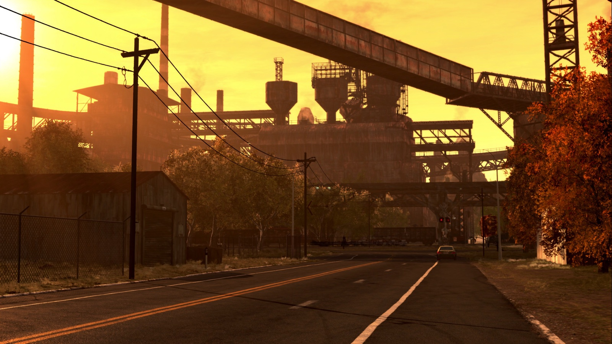
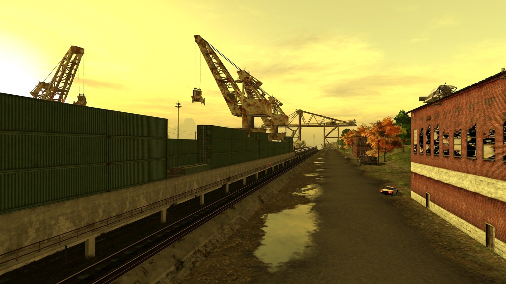
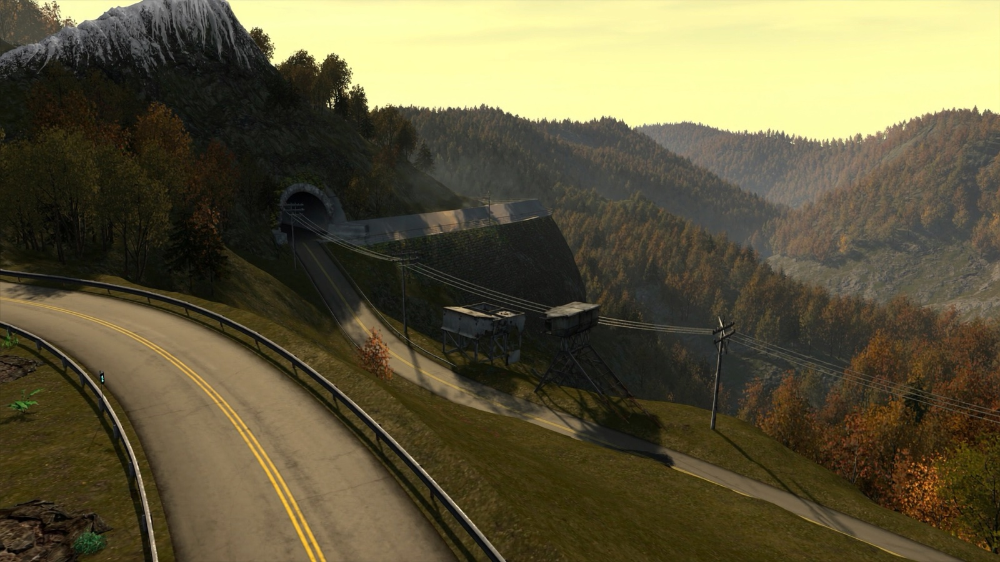

# "Rust Belt" expansion: design proposal

> A fan proposal for discussion. None of this is original game content.
> Golden rule: **if it would not pass as 2005–2006 content by the same studio, it does not go in.** See [ROADMAP.en.md](../../ROADMAP.en.md).

## 1. The idea
- Beating Blacklist #1 of the original opens a **new industrial county** around Rockport.
- It has **4 districts** unlocked in order, like Rosewood → Camden → City in the original.
- A **Blacklist 2** of 15 racers, each with a **unique**, race-built car.
- **English names in every language**, like "Rockport": Millbrook, River Steelworks, Freight Harbor and High Ridge. They are never translated.
- Same look: US Rust Belt, autumn, low sun and the warm, yellowish PS2 tone.

## 2. Proposal map

- Rockport is drawn with its **real road network** (`roads.json`, 6538 segments).
- The new zones are invented. Generated with `bun src/cli/expansion-map.ts` (in `tools/`).
- A **new interstate (I-99)** links the districts outside the city, with accesses to the west, south-west, south and a bridge to the north.

| # | District | What it is | Blacklist 2 |
|---|---|---|---|
| 1 | **Millbrook** | Brick working-class town, churches, water towers. New safehouse, shop and car lot | #15 – #11 |
| 2 | **River Steelworks** | Blast furnaces, conveyors over the street, rail yards | #10 – #6 |
| 3 | **Freight Harbor** | Cranes, narrow container alleys, long piers, lift bridge | #5 – #2 |
| 4 | **High Ridge** | Appalachian mountain pass, dam, tunnels, coal mine | #1 |

## 3. Sketches (Higgsfield, Soul Location model)
Mood references for modelling. Not game assets.

| River Steelworks | Freight Harbor |
|---|---|
|  |  |
| **High Ridge** | **Bridge and interstate** |
|  |  |

## 4. Story (proposal)
1. **Prologue.** The player has just won back the BMW M3 GTR. Mia mentions a neighbouring county where nobody knows their name.
2. **Act I · Millbrook.** Starting from zero: new safehouse, no reputation. A local crew runs the town's races.
3. **Act II · River Steelworks.** County police, tougher than Rockport's, lock the accesses with roadblocks. Pursuits between sheds and rail lines.
4. **Act III · Freight Harbor.** Blacklist 2 moves stolen cars through the port. Cross returns, now as a federal agent.
5. **Act IV · High Ridge.** Blacklist #1 waits on the mountain pass. Final race and a last pursuit across the dam.

New characters with their own names, never copied from other games. Cut-scenes follow the original style: live actors over treated backgrounds.

## 5. How it hooks into the original game
Everything uses systems we have already decoded:

| Piece | Original system | Doc |
|---|---|---|
| Locked districts | `BARRIER_LOCKED_n` groups (story padlocks). Add `BARRIER_LOCKED_16…19` on the new accesses | 03 |
| Blacklist 2, races, milestones | VLT collections in `GAMEPLAY.BIN` (`race_bin`, `milestone`, events), added as mod data | 05 |
| Streets, lanes, traffic and police | `RNgp` road network (nodes, Bézier segments, lane profiles) | 09 |
| Walls and ground | NFSC collision packs (triangles + walls) | 09 |
| Unique cars and parts | Part system: slots, kits, markers, rims, spoilers | 10 |
| Safehouses and shops without loading screens | `safehouse` / `carlot` / `customshop` zones + garages | 07 |
| Data-only mods | `mods/` folder on top of the player's ISO | 08 |

## 6. New cars (proposal)
Classic and period cars at the same level of detail as the game (PS2 polygons and textures):
- Lamborghini Countach, Ferrari Testarossa, Porsche 959, BMW M1, Ford Mustang Boss 429, 1969 Dodge Charger, Toyota AE86, Nissan Skyline R34.
- Every Blacklist 2 car gets its own kit, vinyl, rims and colour. Race design, like the original.
- **Own models**: never ripped from other games.

## 7. Pursuits (proposal)
- County police with new units: sheriff, highway patrol, 4×4s in High Ridge.
- New pursuit breakers: water towers, shed scaffolding, Freight Harbor cranes, logs in High Ridge.
- Roadblocks on the bridge and at the I-99 toll booths.
- Same heat and fines system as the original.

## 8. Rules for modelling the districts
- PS2 budget: 128–256 px textures, warm palette, baked vertex colour like the original.
- Streaming sections the same size as Rockport's. 400 m tiles (doc 06).
- Export to our format: GLB per tile, NFSC collision and road segments. The converter already defines each format.
- Check every piece with the PS2 tone on in the native engine (`G` key).
